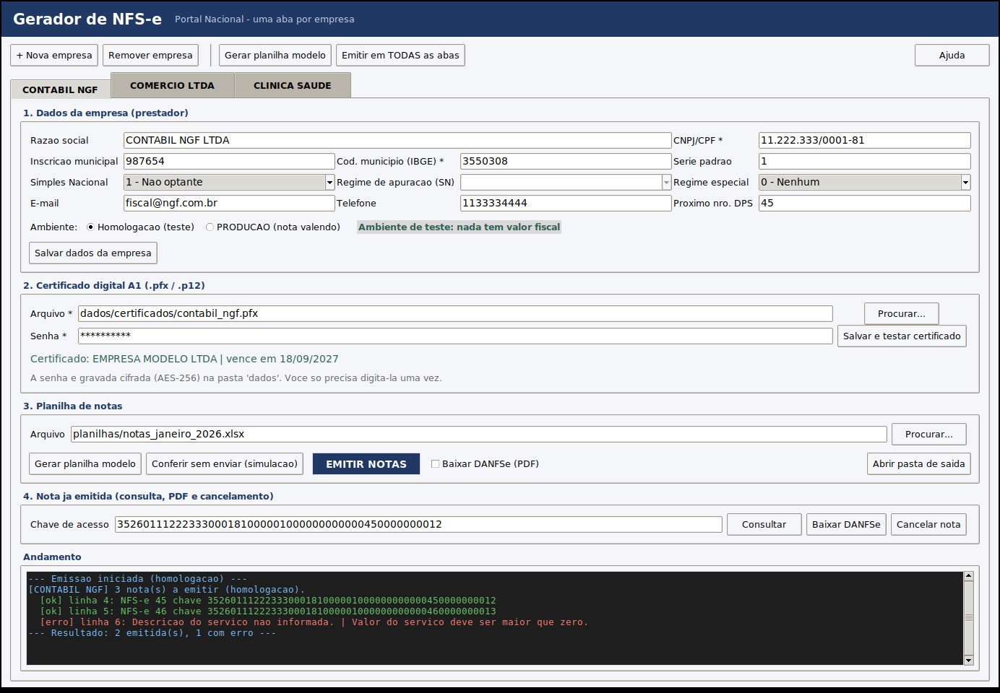

# Gerador de NFS-e — Portal Nacional

Emite notas fiscais de serviço no **Portal Nacional da NFS-e** a partir de uma
planilha do Excel. Cada **aba** é uma empresa, cada **linha** é uma nota.

O certificado digital A1 e a senha ficam guardados no próprio sistema (a senha
cifrada), então você cadastra uma vez e não digita mais.



---

## O que o sistema faz

| Recurso | Descrição |
|---|---|
| Uma aba por empresa | Tanto na janela do sistema quanto na planilha |
| Certificado guardado | O `.pfx` é copiado para `dados/certificados/` e a senha é cifrada com AES-256 |
| Emissão em lote | Lê a planilha e envia nota por nota, com relatório de cada linha |
| Resultado na planilha | Grava Status, Chave de acesso, Nº da NFS-e e Mensagem de volta na planilha |
| Nunca duplica | Linha com chave de acesso preenchida não é reenviada |
| Simulação | Gera, assina e valida o XML sem enviar — e sem gastar numeração de DPS |
| Conferência pelo schema oficial | Todo XML é validado contra os XSD oficiais do Portal (pasta `schemas/`) antes do envio |
| DANFSe | Baixa o PDF da nota autorizada |
| Consulta e cancelamento | Pela chave de acesso, com registro do evento |
| Planilha modelo | Gerada pelo próprio sistema, com ajuda em cada coluna e listas de seleção |

---

## Instalação

Você precisa do **Python 3.10 ou mais novo** ([python.org/downloads](https://www.python.org/downloads/)).
Na instalação em Windows, marque a opção **"Add python.exe to PATH"**.

**Windows:** dê dois cliques em `iniciar.bat`.
**Linux/macOS:** execute `./iniciar.sh`.

Na primeira vez o script cria o ambiente e instala as bibliotecas sozinho
(leva alguns minutos). Depois disso, a abertura é imediata.

Se preferir fazer à mão:

```bash
python -m venv .venv
.venv/bin/pip install -r requirements.txt    # Windows: .venv\Scripts\pip
.venv/bin/python app.py                      # Windows: .venv\Scripts\python
```

---

## Como usar (passo a passo)

### 1. Cadastre a empresa

Clique em **+ Nova empresa** e dê um nome — esse nome vira o nome da aba aqui e
na planilha. Preencha:

- **CNPJ/CPF** do prestador
- **Inscrição municipal**
- **Código do município (IBGE)** — 7 dígitos, do município onde a empresa emite
  (São Paulo = `3550308`, Rio de Janeiro = `3304557`). Consulte em
  [ibge.gov.br/cidades](https://www.ibge.gov.br/cidades-e-estados)
- **Simples Nacional**, **regime especial** e **série padrão**
- **% tributos do Simples** (só ME/EPP): a alíquota efetiva aproximada do mês. O
  Portal exige esse percentual nas notas de ME/EPP (sem ele recusa com `E0712`).
  Atualize quando a alíquota efetiva mudar; a coluna "% tributos Simples Nacional"
  da planilha permite um valor diferente por nota. Para MEI e não optantes, deixe vazio.
- **Ambiente**: comece sempre em **Homologação**

### 2. Cadastre o certificado digital

Em *Certificado digital A1*, escolha o arquivo `.pfx` (ou `.p12`), digite a
senha e clique em **Salvar e testar certificado**. O sistema abre o certificado
na hora: se a senha estiver errada, ele avisa na mesma hora. Aparecem o titular
e a data de vencimento.

A senha é gravada cifrada. Nas próximas vezes o campo já vem preenchido.

> Só funciona com certificado **A1** (arquivo). Certificado A3 (cartão/token)
> não pode ser lido por arquivo e não é suportado.

### 3. Gere a planilha modelo

Clique em **Gerar planilha modelo**. Ela nasce com uma aba para cada empresa
cadastrada, mais as abas `LEIA-ME` e `TABELAS`.

Na aba da empresa:

| Linha | Conteúdo |
|---|---|
| 1 | Faixa colorida com o nome do grupo de colunas |
| 2 | Títulos — **amarelo = obrigatório**. Passe o mouse para ver a ajuda |
| 3 | Exemplo preenchido, em cinza. **Nunca é emitido** (a coluna Status, no fim da planilha, vem marcada como `EXEMPLO`) |
| 4+ | Suas notas, uma por linha |

> Preencheu a nota na linha 3? Ela não sai enquanto a coluna **Status** disser
> `EXEMPLO`. Apague essa palavra da célula da linha 3 nessa coluna (ou passe a nota
> para a linha 4). O sistema avisa qual célula limpar quando detecta essa situação.

### 4. Preencha as notas

O mínimo para uma nota sair:

- Tipo de documento e CNPJ/CPF do tomador, nome
- Código de tributação nacional (6 dígitos)
- Descrição do serviço
- Valor do serviço
- Tributação do ISSQN e retenção do ISSQN

Detalhes que costumam gerar dúvida:

- **Número DPS vazio** = o sistema numera sozinho, seguindo o contador da
  empresa (campo *Próximo nro. DPS*).
- **Valores**: `1000,00` ou `1000.00`, tanto faz.
- **Alíquotas em percentual**: `2` significa 2%.
- **Datas**: `dd/mm/aaaa`. A competência aceita `mm/aaaa`.
- **Colunas de seleção** (tributação, retenção...) têm lista suspensa. O sistema
  usa só o código antes do tracinho — digitar só o código (`1`) também funciona.
- **Textos colados do Word/Excel**: aspas curvas, travessões e emojis são
  ajustados automaticamente para os caracteres que o Portal aceita.
- **Descrição do serviço** pode ter várias linhas (Alt+Enter na célula).

### 5. Confira antes de valer

Clique em **Conferir sem enviar (simulação)**. O sistema valida todas as linhas,
monta e assina o XML, confere contra o schema oficial e não envia nada. Os erros
aparecem no painel *Andamento* com o número da linha. A simulação mostra a
numeração que as notas receberiam, mas **não gasta** os números.

### 6. Emita

Clique em **EMITIR NOTAS**. Ao final:

- a planilha recebe **Status**, **Chave de acesso**, **Nº NFS-e** e **Mensagem**;
- os XML autorizados ficam em `saida/<empresa>/`;
- o histórico completo fica em `saida/<empresa>/historico.jsonl`.

Rodar de novo na mesma planilha só processa as linhas ainda sem chave — não há
risco de emitir a mesma nota duas vezes.

---

## Versão de linha de comando

Para automatizar a rotina ou usar em servidor sem tela:

```bash
python nfse_cli.py empresas listar
python nfse_cli.py empresas adicionar "CONTABIL NGF" --cnpj 11222333000181 \
       --municipio 3550308 --im 987654
python nfse_cli.py certificado "CONTABIL NGF" --arquivo /caminho/cert.pfx
python nfse_cli.py modelo --saida modelos/modelo_nfse.xlsx
python nfse_cli.py emitir notas.xlsx --simular
python nfse_cli.py emitir notas.xlsx --empresa "CONTABIL NGF" --danfse
python nfse_cli.py consultar "CONTABIL NGF" <chave>
python nfse_cli.py cancelar "CONTABIL NGF" <chave> --codigo 1 --motivo "Valor digitado errado"
```

`python nfse_cli.py --help` lista tudo.

---

## Organização das pastas

```
geradorNFSe/
├── app.py                 janela do sistema (uma aba por empresa)
├── nfse_cli.py            mesma coisa por linha de comando
├── iniciar.bat / .sh      atalhos que preparam o ambiente e abrem o sistema
├── modelos/
│   └── modelo_nfse.xlsx   planilha modelo pronta
├── nfse/                  código do sistema
│   ├── config.py          cadastro das empresas
│   ├── cofre.py           cifragem da senha do certificado
│   ├── certificado.py     leitura do .pfx
│   ├── assinatura.py      assinatura digital XMLDSig
│   ├── dps.py             montagem do XML da DPS
│   ├── planilha.py        leitura da planilha
│   ├── modelo_planilha.py geração da planilha modelo
│   ├── esquema.py         validação opcional contra o XSD oficial
│   ├── api.py             comunicação com o Portal Nacional
│   └── emissor.py         emissão em lote
├── dados/                 cadastro + certificados + chave (NÃO versionar)
├── saida/                 XML, PDF e histórico por empresa
├── schemas/               XSD oficiais do layout nacional (v1.01)
└── tests/                 testes automatizados
```

---

## Segurança

- A senha do certificado é cifrada com **AES-256-GCM**. A chave fica em
  `dados/chave.key`, com permissão de leitura só para o dono.
- Para proteção maior em computador compartilhado, defina uma senha mestra:

  ```bash
  export NFSE_SENHA_MESTRE="sua-senha-forte"      # Windows: set NFSE_SENHA_MESTRE=...
  ```

  Com ela, a chave passa a ser derivada da senha (PBKDF2, 480.000 iterações) e
  nada utilizável fica no disco. **Se esquecer essa senha, é preciso cadastrar
  as senhas dos certificados de novo.**
- A chave privada só vira arquivo durante a conexão com o Portal, num diretório
  temporário exclusivo com permissão `600`, e é apagada logo depois.
- `dados/` e `saida/` estão no `.gitignore`. **Nunca versione o certificado.**

---

## Detalhes técnicos

- **DPS layout nacional versão 1.01**, namespace `http://www.sped.fazenda.gov.br/nfse`,
  em dois layouts (ver abaixo).
- **Assinatura** XMLDSig *enveloped* sobre `infDPS`: canonicalização C14N 1.0
  inclusiva, digest SHA-1, assinatura RSA-SHA1, `KeyInfo` com o certificado.
  A assinatura é conferida localmente antes de cada envio.
- **Envio**: `POST {base}/nfse` com o XML em gzip + base64, autenticado por
  mTLS com o próprio certificado A1.
  - Produção: `https://sefin.nfse.gov.br/sefinnacional`
  - Homologação: `https://sefin.producaorestrita.nfse.gov.br/SefinNacional`
- **Validação**: antes de enviar, cada DPS e cada evento são conferidos contra os
  XSD oficiais em `schemas/` (layout v1.01, cópia do projeto
  [nfelib](https://github.com/akretion/nfelib), MIT). Quando o Portal publicar
  uma versão nova do layout, basta trocar os arquivos dessa pasta.
- **Cancelamento**: evento `e101101` em `POST {base}/nfse/{chave}/eventos`.
  Motivos aceitos: `1` erro na emissão, `2` serviço não prestado, `9` outros.
  A descrição precisa ter de 15 a 255 caracteres.
- Uma emissão **nunca** é repetida automaticamente. Se a resposta se perder
  (timeout), o número é considerado usado e a mensagem orienta a consultar antes
  de reenviar.

### Layouts: anterior e NT 009

A Nota Técnica SE/CGNFS-e 009 mudou o layout da DPS: `finNFSe` passou a ser
obrigatório no `infDPS`, a descrição do serviço foi para o fim do `cServ`, as
deduções viraram `vAjusteBC`, o CNPJ alfanumérico passou a ser aceito e as séries
de 90000 a 99999 ficaram reservadas.

| Ambiente | Até 30/11/2026 | A partir de 01/12/2026 (previsto) |
|---|---|---|
| Homologação | NT 009 (exigido desde 20/10/2026) | NT 009 |
| Produção | Anterior | NT 009 |

O sistema escolhe sozinho (`layout = automatico`). Se o Portal recusar o XML por
schema (`E1235`) apontando um campo que mudou entre os layouts, a nota é
reenviada **uma vez** no outro layout, com o mesmo número — a recusa de schema
garante que a DPS não foi aceita. Isso cobre um eventual adiamento da data de
produção. Para fixar um layout:
`python nfse_cli.py empresas editar "EMPRESA" --layout nt009` (ou `anterior`).

Os XSD de cada layout ficam em `schemas/anterior/` e `schemas/nt009/`.

### Rodar os testes

```bash
.venv/bin/python -m pytest
```

São 244 testes cobrindo conversão de dados, cofre de senhas, leitura do
certificado, assinatura digital (inclusive detecção de adulteração), montagem
do XML em 30+ cenários validados contra o **schema oficial dos dois layouts**, leitura/gravação da
planilha, cliente da API, emissão em lote e um roteiro completo da interface
gráfica (pulado em máquinas sem tela).

---

## Antes de emitir em produção

1. Verifique se o município do prestador já aderiu ao Portal Nacional — nem
   todos emitem por lá.
2. Confirme com a contabilidade o **código de tributação nacional** de cada
   serviço e a **alíquota** do município.
3. Rode o lote inteiro em **homologação** e confira o XML gerado em `saida/`.
4. Só então troque o ambiente para **Produção**. O sistema pede confirmação e
   mostra um aviso vermelho quando está nesse modo.

Regras específicas de cada município (alíquota, código de tributação municipal,
obrigatoriedade de campos) não estão no schema e só aparecem na resposta do
Portal: por isso o teste em homologação é indispensável. Documentação oficial em
[gov.br/nfse](https://www.gov.br/nfse).
